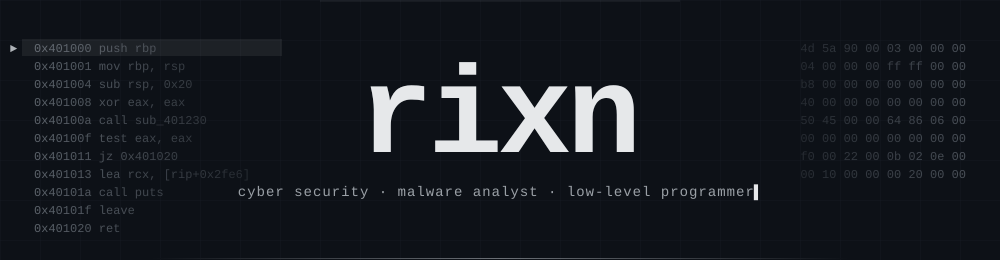

<!-- for me -->

<p align="center"></p>

<p align="center">
  <a href="https://github.com/rixn-911"></a>


## $ ls ~/languages

```text
c++        
go         
python     
asm        
```

<p>
  
</p>


## $ which tools

```text
reverse     ghidra · ida · binary ninja · radare2
debug       x64dbg · windbg · gdb · pwndbg
detect      yara · sigma · capa
build       c++ · go · python · nasm
```


## $ tail ~/now

```text
[+] x64 assembly, getting fluent
[+] edr internals and telemetry
[+] kernel-mode detection
[-] sleep
```


<p align="center"><sub><code>return 0;  // nevermore</code></sub></p>
